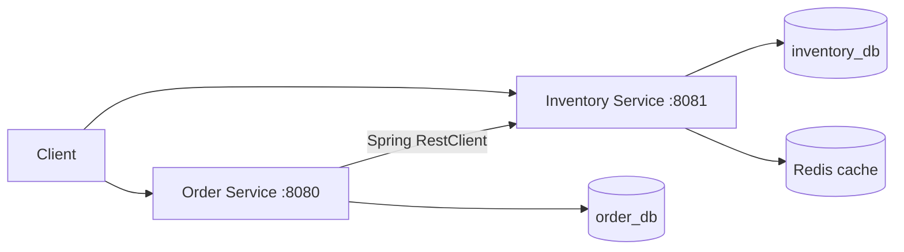

# Distributed Order Processing System

A learning backend using Java 17, Spring Boot 4.0.8, PostgreSQL 18.6, Redis 7,
Maven, Docker Compose, and GitHub Actions.

[](https://github.com/pranshu1606/distributed-order-processing-system/actions/workflows/ci.yml)

On one laptop it sustains **400 checkouts/s** (order p95 9 ms) and keeps stock
exact under overload and an 8-second database outage: **0 lost units and 0
duplicate orders** across every stress run. See
[stress and resilience testing](docs/stress-and-resilience.md) and the
[testing and validation report](docs/testing-and-validation.md).

## Architecture



Each service owns its database, currently hosted in one PostgreSQL container.
Order creation requests an authoritative inventory reduction, then saves the order with
status CREATED. Clients send only productId and quantity.

Stock reduction runs in a transaction using one conditional PostgreSQL update:
`UPDATE ... SET quantity = quantity - ? WHERE product_id = ? AND quantity >= ? RETURNING ...`.
PostgreSQL locks the row and rechecks available stock after competing updates.
PostgreSQL is the authority for stock decisions; reduction bypasses Redis.
Inventory GET responses use Redis with a 60-second TTL. Successful reductions
trigger eviction through a transaction-aware cache manager. Redis writes and
eviction wait for completion instead of running in the background. Cached reads are
not strongly consistent: a racing read can repopulate an old value. Order
creation does not use a preliminary cached stock check; the locked reduction
checks availability. Its HTTP client uses a bounded connection pool, bounded
wait/read timeouts, and disables automatic retries for stock mutations.

**Failure handling:** every order carries a reservation ID. Inventory records it
in the same transaction as the stock reduction, so retries never reduce twice.
If Inventory times out or the order cannot be saved, Order releases the
reservation in the background (release is idempotent and blocks a late
reduction) and answers `503` with `Retry-After`. Clients may send an
`Idempotency-Key` header so a retried order is never duplicated. Release
retries are kept in memory only, so a crash can leave a reservation without an
order; automatic reconciliation is future work. See
[stress and resilience testing](docs/stress-and-resilience.md).
This is a learning demo, not a complete checkout system.

## Start locally

Install Docker with Compose v2. Docker builds both apps; this path needs no
local Java or Maven installation.

On the existing laptop, reuse its database volume with the ignored override:

```powershell
docker compose -f compose.yaml -f compose.local.yaml up --build -d --wait
docker compose -f compose.yaml -f compose.local.yaml ps
```

On a fresh machine:

```sh
docker compose up --build -d --wait
docker compose ps
```

Database initialization creates order_db only on an empty PostgreSQL data
directory. Existing volumes keep their data and do not rerun initialization.
Do not use `down -v` or delete database volumes to fix startup problems.

Check health without writing business data:

```powershell
Invoke-RestMethod http://localhost:8081/actuator/health
Invoke-RestMethod http://localhost:8080/actuator/health
```

Both should report UP and all four containers should be healthy. App probes run
every 10 seconds, with a 60-second startup grace period, 5-second timeout, and
6 retries. Inventory waits for healthy PostgreSQL and Redis; Order waits for
healthy PostgreSQL and Inventory. These conditions control startup; they do not
automatically restart unhealthy processes or guarantee future requests.

To rebuild only laptop apps while leaving dependencies running:

```powershell
docker compose -f compose.yaml -f compose.local.yaml up --build --no-deps -d --wait inventory-service order-service
```

Use `logs --tail 100` with the same Compose options for diagnostics, and `stop`
to stop containers without deleting data.

## Try the API

These examples write data and reduce stock. Use a fresh demo or a new product
ID; adding an existing product returns a conflict.

```powershell
Invoke-RestMethod -Method Post -Uri http://localhost:8081/inventory -ContentType 'application/json' -Body '{"productId":101,"productName":"Demo product","quantity":10}'
Invoke-RestMethod -Method Post -Uri http://localhost:8080/orders -ContentType 'application/json' -Body '{"productId":101,"quantity":2}'
Invoke-RestMethod http://localhost:8081/inventory/101
Invoke-RestMethod http://localhost:8080/orders
```

| Service | Method | Endpoint | Purpose |
| --- | --- | --- | --- |
| Inventory | POST | /inventory | Create stock |
| Inventory | GET | /inventory/{productId} | Read stock (cached) |
| Inventory | PUT | /inventory/{productId}/reduce?quantity=2&reservationId={uuid} | Atomically check and reduce stock (reservationId optional, makes retries safe) |
| Inventory | POST | /inventory/reservations/{reservationId}/release | Return reserved stock exactly once |
| Order | POST | /orders (optional `Idempotency-Key` header) | Create an order and reduce stock |
| Order | GET | /orders/{id} | Look up an order |
| Order | GET | /orders | List orders |
| Both | GET | /actuator/health | Check health |

Validation failures return 400, missing products/orders return 404, and
insufficient stock returns 409. Reduction quantities must be positive.

## Test safely

This separate stack never mounts the laptop database volume. PostgreSQL test
data lives in memory; database and Redis ports are not published.

```sh
docker compose -p order-verification -f compose.test.yaml up --abort-on-container-exit --exit-code-from tests
docker compose -p order-verification -f compose.test.yaml down
```

The first command returns the tests' exit code and runs both Maven verify suites
on Java 17. Inventory tests start ten simultaneous reductions against five
units: exactly five must succeed, five must be rejected, and stock must finish
at zero. Rejected reductions must leave stock unchanged. Reservation tests check
that retries never reduce twice, release returns stock exactly once, and a
reduce racing a release always ends with stock restored (repeated five times).
Order tests cover compensation after timeouts or failed saves and
Idempotency-Key retries. 35 tests in total (Inventory 16, Order 19).

For an isolated image/startup check (Compose 2.24.4+), without publishing app
ports or using the laptop database volume:

```sh
docker compose -p order-smoke -f compose.yaml -f compose.smoke.yaml up --build -d --wait
docker compose -p order-smoke -f compose.yaml -f compose.smoke.yaml exec inventory-service curl --fail http://localhost:8081/actuator/health
docker compose -p order-smoke -f compose.yaml -f compose.smoke.yaml exec order-service curl --fail http://localhost:8080/actuator/health
docker compose -p order-smoke -f compose.yaml -f compose.smoke.yaml down
```

The smoke overlay uses PostgreSQL in memory; its data is disposable.

For manual Java development, supply dedicated development/test PostgreSQL
and Redis instances, configure the variables below, and run `./mvnw
spring-boot:run` inside each service (Windows: `.\mvnw.cmd spring-boot:run`).
Use `verify` instead to run tests. Integration tests insert/delete test rows;
do not run them against valuable data.

| Variable | Inventory | Order |
| --- | --- | --- |
| SPRING_DATASOURCE_URL | JDBC URL for inventory_db | JDBC URL for order_db |
| SPRING_DATASOURCE_USERNAME | Database user | Database user |
| SPRING_DATASOURCE_PASSWORD | Database password | Database password |
| REDIS_HOST, REDIS_PORT | Redis address; default localhost:6379 | Unused |
| INVENTORY_SERVICE_URL | Unused | Inventory URL; default http://localhost:8081 |

Portable Compose supplies internal addresses and publishes no database/Redis
ports. Hibernate currently uses ddl-auto=update; schema migrations are future work.

## Stress and resilience results

Measured 2026-10-13 on one laptop (Docker Desktop, 3.9 GiB VM) with the isolated
demo stack and `scripts/run_k6_capacity.py`. One checkout = a cached stock read
plus an order. A stage passes when order p95 < 1 s, read p95 < 500 ms, at least
99% of orders succeed, and nothing unexpected happens; afterwards PostgreSQL is
audited.

| Scenario | Result |
| --- | --- |
| Capacity, 30 products | Passed up to **400 checkouts/s** (order p95 9 ms); 800/s missed the latency target |
| Flash sale, 3 hot products | Passed up to **400 checkouts/s** (order p95 13 ms) |
| Overload at 1,600/s | ~700 orders/s processed, p95 1.96 s, 0 errors |
| Database frozen 8 s at 100 orders/s, clients retry | All 2,784 checkouts ended in an order after 362 retries |
| Same freeze, before reservations were added | 135 units of stock lost |
| Database audit, every run after the fix | 0 lost units, 0 duplicate orders, 0 reservations without an order |

If each shopper checks out once a minute, 400 checkouts/s corresponds to about
24,000 active shoppers. That is an assumption-based conversion, not a test of
that many connections. Laptop results vary with free memory; see the
[full report](docs/stress-and-resilience.md) for method, caveats and limits.

## CI and hosting

For a portfolio walkthrough without a frontend, use the
[API demo kit](docs/api-demo.md): a Postman collection, a recording-ready
PowerShell script, and an isolated local demo stack.
The [external catalog traffic test](docs/external-api-testing.md) imports
sample products from DummyJSON and verifies concurrent ordering against the
isolated demo databases.
The [k6 test report](docs/k6-testing.md) records a 30-second normal-traffic run
and a 30-user contention burst, with authoritative stock/order checks afterward.

GitHub Actions runs both test suites against isolated PostgreSQL/Redis, builds
both images, and checks healthy Compose startup and health endpoints on every
push. The badge at the top shows the latest
[workflow run](https://github.com/pranshu1606/distributed-order-processing-system/actions).

See [demo deployment instructions](docs/demo-hosting.md). Files for a small VM,
HTTPS, and password access are prepared. A server/domain and live verification
are pending.

## Roadmap

- [x] Inventory/order APIs, validation, and exception handling
- [x] PostgreSQL database ownership per service
- [x] Redis cache, TTL, and eviction
- [x] Transactional reduction with PostgreSQL row locking
- [x] Docker builds, Compose, database initialization, health checks
- [x] GitHub Actions tests and image builds
- [x] Push and verify CI for locking/startup checks (c26efb6)
- [ ] Launch and verify public demo
- [x] Reservations/compensation and idempotent order creation
- [x] Fail-fast timeouts, 503 + Retry-After, arrival-rate and chaos stress tests
- [ ] Automatic reconciliation of reservations left by a crash
- [ ] Schema migrations (Flyway) instead of ddl-auto
- [ ] Horizontal scaling: several service replicas behind a load balancer
- [ ] Kubernetes and Azure (later milestones)
- [ ] Optional payment, notification, and messaging
