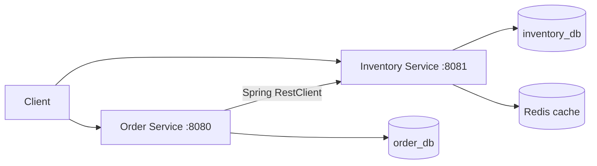

# Distributed Order Processing System

A learning backend using Java 17, Spring Boot 4.0.8, PostgreSQL 18.6, Redis 7,
Maven, Docker Compose, and GitHub Actions.

## Architecture



Each service owns its database, currently hosted in one PostgreSQL container.
Order creation reads inventory, requests a reduction, then saves the order with
status CREATED. Clients send only productId and quantity.

Stock reduction runs in a transaction using a PostgreSQL pessimistic row lock.
Concurrent reductions for the same product wait, then check the current stock.
PostgreSQL is the authority for stock decisions; reduction bypasses Redis.
Inventory GET responses use Redis with a 60-second TTL. Successful reductions
trigger eviction through a transaction-aware cache manager. Redis writes and
eviction wait for completion instead of running in the background. Cached reads are
not strongly consistent: a racing read can repopulate an old value. Order's
preliminary cached check can reject a request based on stale data; the locked
reduction is the final stock check.

**Reliability gap:** stock reduction can succeed before saving the order fails.
Retries can reduce stock again. Reservations/compensation and idempotency remain
unfinished. This is a learning demo, not a complete checkout system.

## Start locally

Install Docker with Compose v2. Docker builds both apps; this path needs no
local Java or Maven installation.

On the existing laptop, reuse its database volume with the ignored override:

```powershell
docker compose -f compose.yaml -f compose.local.yaml up --build -d --wait
docker compose -f compose.yaml -f compose.local.yaml ps
```

On a fresh machine:

```sh
docker compose up --build -d --wait
docker compose ps
```

Database initialization creates order_db only on an empty PostgreSQL data
directory. Existing volumes keep their data and do not rerun initialization.
Do not use `down -v` or delete database volumes to fix startup problems.

Check health without writing business data:

```powershell
Invoke-RestMethod http://localhost:8081/actuator/health
Invoke-RestMethod http://localhost:8080/actuator/health
```

Both should report UP and all four containers should be healthy. App probes run
every 10 seconds, with a 60-second startup grace period, 5-second timeout, and
6 retries. Inventory waits for healthy PostgreSQL and Redis; Order waits for
healthy PostgreSQL and Inventory. These conditions control startup; they do not
automatically restart unhealthy processes or guarantee future requests.

To rebuild only laptop apps while leaving dependencies running:

```powershell
docker compose -f compose.yaml -f compose.local.yaml up --build --no-deps -d --wait inventory-service order-service
```

Use `logs --tail 100` with the same Compose options for diagnostics, and `stop`
to stop containers without deleting data.

## Try the API

These examples write data and reduce stock. Use a fresh demo or a new product
ID; adding an existing product returns a conflict.

```powershell
Invoke-RestMethod -Method Post -Uri http://localhost:8081/inventory -ContentType 'application/json' -Body '{"productId":101,"productName":"Demo product","quantity":10}'
Invoke-RestMethod -Method Post -Uri http://localhost:8080/orders -ContentType 'application/json' -Body '{"productId":101,"quantity":2}'
Invoke-RestMethod http://localhost:8081/inventory/101
Invoke-RestMethod http://localhost:8080/orders
```

| Service | Method | Endpoint | Purpose |
| --- | --- | --- | --- |
| Inventory | POST | /inventory | Create stock |
| Inventory | GET | /inventory/{productId} | Read stock (cached) |
| Inventory | PUT | /inventory/{productId}/reduce?quantity=2 | Reduce stock with a database row lock |
| Order | POST | /orders | Create an order and reduce stock |
| Order | GET | /orders/{id} | Look up an order |
| Order | GET | /orders | List orders |
| Both | GET | /actuator/health | Check health |

Validation failures return 400, missing products/orders return 404, and
insufficient stock returns 409. Reduction quantities must be positive.

## Test safely

This separate stack never mounts the laptop database volume. PostgreSQL test
data lives in memory; database and Redis ports are not published.

```sh
docker compose -p order-verification -f compose.test.yaml up --abort-on-container-exit --exit-code-from tests
docker compose -p order-verification -f compose.test.yaml down
```

The first command returns the tests' exit code and runs both Maven verify suites
on Java 17. Inventory tests start ten simultaneous reductions against five
units: exactly five must succeed, five must be rejected, and stock must finish
at zero. Rejected reductions must leave stock unchanged. Order has controller,
service, and context-startup tests.

For an isolated image/startup check (Compose 2.24.4+), without publishing app
ports or using the laptop database volume:

```sh
docker compose -p order-smoke -f compose.yaml -f compose.smoke.yaml up --build -d --wait
docker compose -p order-smoke -f compose.yaml -f compose.smoke.yaml exec inventory-service curl --fail http://localhost:8081/actuator/health
docker compose -p order-smoke -f compose.yaml -f compose.smoke.yaml exec order-service curl --fail http://localhost:8080/actuator/health
docker compose -p order-smoke -f compose.yaml -f compose.smoke.yaml down
```

The smoke overlay uses PostgreSQL in memory; its data is disposable.

For manual Java development, supply dedicated development/test PostgreSQL
and Redis instances, configure the variables below, and run `./mvnw
spring-boot:run` inside each service (Windows: `.\mvnw.cmd spring-boot:run`).
Use `verify` instead to run tests. Integration tests insert/delete test rows;
do not run them against valuable data.

| Variable | Inventory | Order |
| --- | --- | --- |
| SPRING_DATASOURCE_URL | JDBC URL for inventory_db | JDBC URL for order_db |
| SPRING_DATASOURCE_USERNAME | Database user | Database user |
| SPRING_DATASOURCE_PASSWORD | Database password | Database password |
| REDIS_HOST, REDIS_PORT | Redis address; default localhost:6379 | Unused |
| INVENTORY_SERVICE_URL | Unused | Inventory URL; default http://localhost:8081 |

Portable Compose supplies internal addresses and publishes no database/Redis
ports. Hibernate currently uses ddl-auto=update; schema migrations are future work.

## CI and hosting

GitHub Actions runs both test suites against isolated PostgreSQL/Redis, builds
both images, and now checks healthy Compose startup and health endpoints.
See [workflow runs](https://github.com/pranshu1606/distributed-order-processing-system/actions).
Last remotely verified successful commit: 9a61323 (checked 2026-10-11).
Current local changes need a push and a new run before claiming CI coverage.

See [demo deployment instructions](docs/demo-hosting.md). Files for a small VM,
HTTPS, and password access are prepared. A server/domain and live verification
are pending.

## Roadmap

- [x] Inventory/order APIs, validation, and exception handling
- [x] PostgreSQL database ownership per service
- [x] Redis cache, TTL, and eviction
- [x] Transactional reduction with PostgreSQL row locking
- [x] Docker builds, Compose, database initialization, health checks
- [x] GitHub Actions tests and image builds
- [ ] Push and verify CI for latest locking/startup checks
- [ ] Launch and verify public demo
- [ ] Reservations/compensation and idempotent order creation
- [ ] Timeouts, failure recovery, and schema migrations
- [ ] Kubernetes and Azure (later milestones)
- [ ] Optional payment, notification, and messaging
