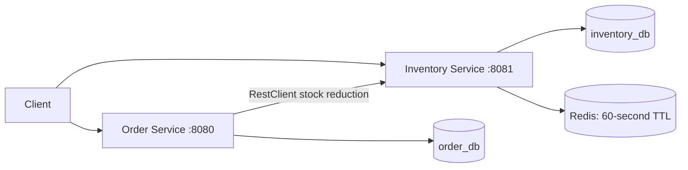
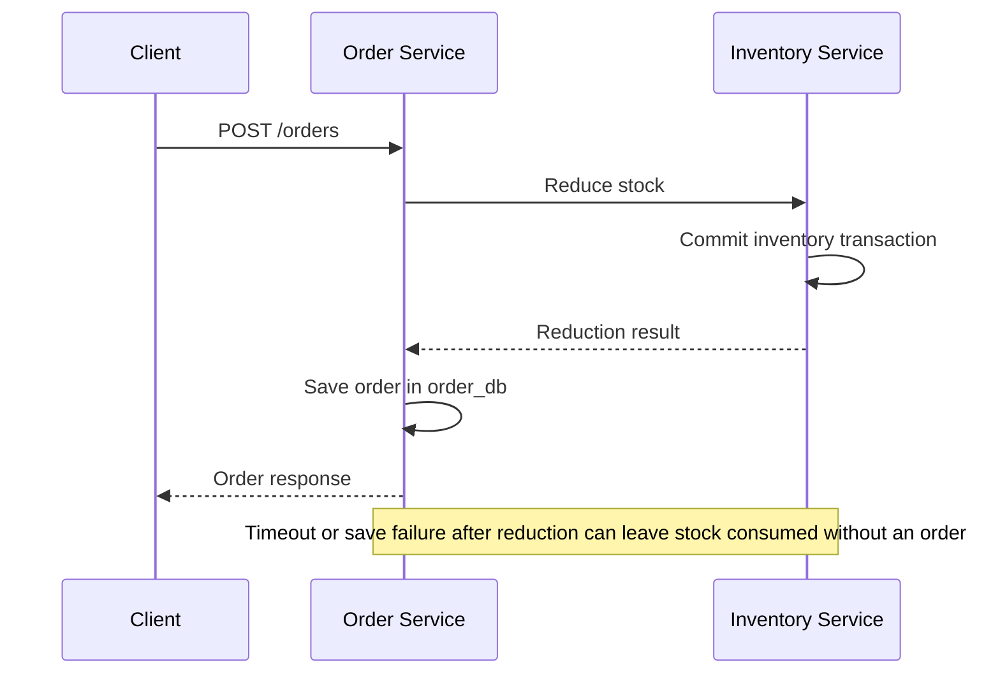

# Project testing and validation report

Status recorded on **2026-10-12**. This report brings together the implementation,
test evidence, demo instructions, failures, and remaining work. Measurements below
are historical results from 2026-10-10/11, not measurements of the latest code.

## Current status

The backend has working inventory/order APIs, Redis caching, Docker startup
checks, automated Java tests, and an API demo that can be recorded without a
frontend. Earlier local k6 tests passed at 10 virtual users and a 30-user stock
contention burst. **Neither 1,000 nor 12,000 concurrent users has passed.**

Docker and the services were stopped after a Docker/WSL storage failure. The last
disk check found approximately 0.81 GiB free on C:. Recovery, database preservation
checks, and verification of the latest changes are pending. No database volumes
were deleted or reset. Public hosting files are prepared; no public deployment
has been verified.

| Version / milestone | Evidence and status |
| --- | --- |
| Commit `c26efb6` | Locking/startup changes passed remote CI; checked 2026-10-11 |
| Earlier API demo and k6 version | Walkthrough, Postman assertions, external integration, and 10/30-user k6 tests passed locally |
| First performance tuning | 18 Java test executions passed; warm walkthrough passed; 100-user benchmark failed |
| Latest conditional-update and configuration changes | Implemented locally; final build, 19 expected Java test executions, runtime checks, and load tests remain pending |

The [successful historical CI run](https://github.com/pranshu1606/distributed-order-processing-system/actions/runs/38157943691)
does not cover subsequent uncommitted local changes. A new push and CI run are
required to verify those changes remotely.

## Architecture and request behavior

Java 17 / Spring Boot 4.0.8 services use PostgreSQL 18.6 and Redis 7. Maven builds
the applications, Docker Compose runs them, and GitHub Actions provides CI.



Each service owns its database; both databases currently share a PostgreSQL
container. PostgreSQL decides whether stock can be reduced. Redis speeds up
inventory reads and is evicted after a successful committed reduction. A racing
read can repopulate an older cached value, so cached reads are not strongly
consistent. Final test accounting always queries PostgreSQL.

The latest implementation reduces stock using a parameterized conditional
`UPDATE ... WHERE quantity >= ? RETURNING ...` inside a transaction. It replaces
the previously tested locking SELECT followed by an entity update. This reduces
the number of database operations; a performance improvement has not yet been
measured. See [InventoryStockRepository](../inventory-service/src/main/java/com/pranshu/inventory_service/repository/InventoryStockRepository.java)
and [InventoryService](../inventory-service/src/main/java/com/pranshu/inventory_service/service/InventoryService.java).

Order creation sends a stock-reduction request before saving its own order.
These are separate transactions across two services:



Reservations/compensation and idempotency are unfinished. An HTTP timeout can
also occur after an order was saved. Retrying an order request can reduce stock
again; clients cannot safely infer database state from a timeout alone.

| API behavior | Expected outcome |
| --- | --- |
| Create inventory, read inventory, reduce available stock | HTTP 200 |
| Create an order with available stock | HTTP 200, saved order with status `CREATED` |
| Look up an order or list orders | HTTP 200 |
| Invalid request / nonpositive reduction quantity | HTTP 400 |
| Missing inventory or order | HTTP 404 |
| Duplicate product or insufficient stock | HTTP 409 |
| Actuator health | HTTP 200 with status `UP` when dependencies are healthy |

Endpoint examples and environment variables are in the [root README](../README.md).

## Automated Java coverage

The last fully completed suite had **18 passing test executions**: 6 Inventory
and 12 Order. Adding the rollback/cache test brings the current expected total
to **19**, counting the concurrency test's three repetitions. The latest suite
was interrupted during bootstrap and must not be reported as passing.

| Source | Coverage |
| --- | --- |
| [InventoryConcurrencyTests](../inventory-service/src/test/java/com/pranshu/inventory_service/InventoryConcurrencyTests.java) | Three repetitions of ten simultaneous reductions against five units; exactly five successes/five rejections and final stock zero. Successful eviction, rollback restoring database stock and retaining cached stock, and rejected reductions leaving stock unchanged |
| [InventoryServiceApplicationTests](../inventory-service/src/test/java/com/pranshu/inventory_service/InventoryServiceApplicationTests.java) | Spring application context starts with test infrastructure |
| [OrderControllerTest](../order-service/src/test/java/com/pranshu/order_service/controller/OrderControllerTest.java) | Six tests: creation, listing, lookup, missing order, missing product ID, and negative quantity validation |
| [OrderServiceTest](../order-service/src/test/java/com/pranshu/order_service/service/OrderServiceTest.java) | Five tests: lookup/listing, missing order, successful reduction/save, and rejecting insufficient stock without saving; creation uses reduction directly without a cached GET precheck |
| [OrderServiceApplicationTests](../order-service/src/test/java/com/pranshu/order_service/OrderServiceApplicationTests.java) | Spring application context starts |

Controller/service mocks verify application behavior; they do not measure network
reliability. Inventory integration tests exercise real PostgreSQL/Redis. Current
coverage does not establish recovery from every cross-service partial failure.

## Manual, integration, and deployment checks

| Check | Historical result | What it demonstrates |
| --- | --- | --- |
| Compose configuration | Portable/laptop overlays validated; later test/performance configuration parsing also passed | YAML and merged configuration validity; not runtime health |
| Image/startup health | Both apps built; all four laptop containers healthy; both endpoints `UP` | Inventory became healthy before Order started |
| Laptop data preservation | Same PostgreSQL container/volume and unchanged 2 inventory / 6 order rows and fingerprints | Earlier recreations and first engine recovery preserved data; final recovery recheck pending |
| PowerShell API walkthrough | Ten-step walkthrough passed, including a warm run after first tuning | Stock 10 -> 8, order lookup, expected 409/400, unchanged stock after rejection |
| Postman / Newman | Ten requests, 20 assertions passed | A repeatable API demonstration without a frontend |
| External catalog integration | 30 local order attempts: 15 successes, 15 expected 409s, zero unexpected failures | Imported products work with local concurrent ordering and stock accounting |
| Local deployment proxy | Unauthenticated request rejected with 401; authenticated health/API checks passed | Local Caddy configuration and access protection; no live DNS/TLS verification |
| Remote CI | `c26efb6` run passed | Historical tests, image builds, healthy Compose startup; latest local work uncovered |

The external test fetches three products once from DummyJSON, assigns synthetic
local stock of five units each, and sends concurrent requests only to the local
demo. DummyJSON stock is never authoritative, and the public API is not load
tested. The short integration run took 2.75 seconds; its timing is not a capacity
benchmark. See [external API testing](external-api-testing.md).

For a recording, use the [API demo guide](api-demo.md),
[PowerShell walkthrough](../scripts/Invoke-ApiDemo.ps1), and
[Postman collection](../demo/portfolio.postman_collection.json).
Hosting configuration and pending public verification are covered in
[demo hosting](demo-hosting.md).

## k6 results

Tests used Grafana k6 2.3.0 in Docker on the same laptop as the services.
Normal traffic performs an inventory GET, a one-unit order POST, and a 200 ms
pause per iteration. Three products concentrate stock contention. These are
closed-loop virtual-user tests: throughput drops when responses slow down.
Virtual users are concurrent scripts, not requests per second or unique people.

### Successful baseline

| Measurement | Normal traffic | Contention burst |
| --- | ---: | ---: |
| Virtual users | 10 | 30 |
| Duration / execution | 30 seconds plus completion of in-flight work | One order per user |
| HTTP requests | 1,214 | 30 |
| Saved orders | 607 | 15 |
| Expected HTTP 409 stock rejections | 0 | 15 |
| Unexpected HTTP failures | 0 | 0 |
| Order average latency | 202.44 ms | 276.59 ms |
| Order p95 latency | 533.15 ms | 336.66 ms |

The normal run took 30.17 seconds overall: 40.24 HTTP requests/second and
20.12 orders/second. Inventory-read p95 was 139.33 ms. The slowest order took
2.81 seconds. A p95 of 533 ms means approximately 95% of measured order
responses were at or below that duration; it does not bound every response.

All thresholds passed. SQL checks found normal saved-order counts of
202/202/203 and stock 9,798/9,798/9,797, from 10,000 initial units each.
Contention produced five saved orders and zero remaining stock per product.
Successful responses matched saved orders, and consumed stock matched saved
order quantities. This establishes accounting for these runs only.

### Failed stress attempts and follow-up

| Attempt | HTTP requests / failures | Order p95 | Outcome |
| --- | --- | --- | --- |
| Original 100 users, 10 seconds | 562 / 7.47% | 5,001 ms | Failed thresholds; 239 successful order responses |
| Original 1,000 users, 10 seconds | 2,808 / 65.14% | 5,002 ms | Failed thresholds; zero successful order responses |
| Original 3,000 users | Complete summary unavailable | Unavailable | Docker engine connection interrupted; cause not conclusively diagnosed |
| Original 6,000 users | Complete summary unavailable | Unavailable | Generator OOM-killed; `OOMKilled=true` |
| Original 12,000 users | Complete summary unavailable | Unavailable | Manually stopped during recovery; `OOMKilled=false`; no valid capacity result |
| First tuning, 100 users, 30 seconds | 1,248 / 38.54% | 5,186 ms | Failed; 1,000-user follow-up skipped |

The original engine interruption restarted the disposable tmpfs demo database,
so final accounting for that stress run is unavailable. The engine had about
3.7 GiB of memory; the generator was limited to 768 MiB and two CPUs. These
limits and the shared host affect results. Exit 137 alone does not prove an OOM;
the recorded container state distinguishes the 6,000 and 12,000 attempts.

The first tuning follow-up exposed a concrete reliability failure:

- 624 stock units were consumed, but only 529 one-unit orders were saved:
  **95 consumed units had no saved order**.
- k6 received 239 successful order responses, while SQL found 529 orders:
  **290 saved orders had no successful client response recorded**.
- Order logs showed inventory mutation read timeouts. A missing HTTP success
  therefore cannot be counted as a harmless rejected order.

This benchmark failed both performance and end-to-end accounting expectations.
The later Docker/WSL failure recorded disk I/O errors, an aborted EXT4 journal,
a read-only remount, and a daemon crash, while C: had about 0.32 GiB free.
Low disk space was observed; the precise cause of the I/O failure is unproven.
It must not be used to retrospectively explain the earlier 3,000-user interruption.

Full scenario details are in [the k6 report](k6-testing.md).

## Changes made after the failures

| Change | Why | Verification boundary |
| --- | --- | --- |
| Remove preliminary cached stock GET from order creation | Avoid a redundant request and make PostgreSQL reduction decide availability | First tuning Java tests and warm walkthrough passed |
| Disable SQL printing and Open-in-View | Reduce logging overhead and keep persistence work within service operations | Included in first tuning; larger-load result still failed |
| Bounded Apache HTTP connection pool, no automatic mutation retries | Bound connection usage and prevent hidden repeated stock reductions | First tuning tested; latest added connect-timeout configuration pending |
| Demo-only JVM, thread, and connection-pool bounds | Control resource use on the laptop | First tuning ran; does not establish improved capacity |
| Conditional JDBC stock update and rollback/cache test | Reduce database round trips and verify transaction participation | Intermediate images built; latest suite/runtime verification interrupted |
| G1 selection, Maven memory limits and dependency caches | Bound build/test resource use and reduce repeated dependency downloads | Final build/test configuration pending runtime verification |
| Fail-stop high-user runner with actual-user and SQL checks | Prevent larger stages after failure and reject incomplete/mismatched evidence | Python compilation, CLI checks, and JavaScript syntax passed; latest runner not load-tested |

These are implementation changes, not proof that 1,000 users now work. The
cross-service reservation/idempotency gap remains even if latency improves.

## Isolation and evidence files

| Configuration | Purpose |
| --- | --- |
| [compose.yaml](../compose.yaml) | Portable application stack |
| `compose.local.yaml` (ignored) | Reuses the existing laptop database volume |
| [compose.test.yaml](../compose.test.yaml) | Separate `order-verification` project, in-memory PostgreSQL, real Redis, Java suites, Maven dependency cache |
| [compose.smoke.yaml](../compose.smoke.yaml) | Disposable image/startup checks |
| [compose.api-demo.yaml](../compose.api-demo.yaml) | Separate `portfolio-demo` project with temporary database; localhost ports 18080/18081 |
| [compose.performance.yaml](../compose.performance.yaml) | Demo-only resource tuning overlay |
| [compose.demo.yaml](../compose.demo.yaml) | Prepared VM/public-demo deployment configuration |

Test/demo PostgreSQL uses tmpfs: restarting its container loses its database
contents. These stacks never mount the laptop database volume. Always capture
SQL evidence before stopping or restarting the demo database.

Generated files in `demo/artifacts/` are ignored by Git and are local evidence,
not files guaranteed to exist in a fresh clone:

| File | Contents |
| --- | --- |
| `external-api-run.json` | Imported catalog mapping, integration responses, SQL accounting |
| `k6-verification.json` | Earlier baseline/contention metrics and database checks |
| `k6-normal-summary.json`, `k6-contention-summary.json` | Baseline k6 metrics |
| `k6-high-users-verification.json` | Original stress stages and incomplete-result/recovery details |
| `k6-1000-users-verification-1791742979259000.json` | First tuning's failed 100-user stage and accounting mismatch |
| `k6-{maxUsers}-users-verification-{runId}.json` | New runner's per-run report, stage/container state, actual VUs, SQL verification |
| `k6-*.log`, `order-load-errors.log` | Diagnostic output |

The report above preserves the useful results in versionable documentation.
Individual per-stage summary/log names can be overwritten on rerun; retain the
per-run JSON and relevant logs when sharing benchmark evidence.

## How to verify after recovery

Run commands from the repository root. First free at least 5 GiB on C: as agreed,
restore Docker, and confirm engine health. The high-user runner has a lower
2 GiB free-space guard; passing that guard does not guarantee enough resources.
Do not overlap Maven tests, image builds, and load tests on this laptop.

### 1. Recheck the existing database

Start existing dependencies without rebuilding apps or replacing database data:

```powershell
docker compose -f compose.yaml -f compose.local.yaml up -d postgres redis
docker compose -f compose.yaml -f compose.local.yaml ps
docker inspect distributed-order-processing-system-postgres-1 --format '{{.Id}} {{json .Mounts}}'
docker exec distributed-order-processing-system-postgres-1 psql -U postgres -d inventory_db -At -c "SELECT count(*), md5(coalesce(jsonb_agg(to_jsonb(i) ORDER BY id)::text, '[]')) FROM inventory i;"
docker exec distributed-order-processing-system-postgres-1 psql -U postgres -d order_db -At -c "SELECT count(*), md5(coalesce(jsonb_agg(to_jsonb(o) ORDER BY id)::text, '[]')) FROM orders o;"
```

Earlier baselines were `2|350328e56012d1493c93c92c33999471` for inventory and
`6|ee24ad4826a13dfdb80e3d424e074b02` for orders. Recheck them after recovery.
A difference requires investigation; do not reset data to make it match.

### 2. Run Java regressions, then the API walkthrough

```powershell
docker compose -p order-verification -f compose.test.yaml run --rm tests
docker compose -p order-verification -f compose.test.yaml stop postgres redis
docker compose -p portfolio-demo -f compose.yaml -f compose.api-demo.yaml -f compose.performance.yaml up --build -d --wait --wait-timeout 240
powershell -ExecutionPolicy Bypass -File scripts/Invoke-ApiDemo.ps1
```

Require successful Maven exit and the expected 19 test executions before
continuing. Check all four demo containers are healthy and the walkthrough
passes. A previous cold walkthrough timed out once; its cause was not proven.
A later warm pass does not erase that observation.

### 3. Run the baseline, then the 1,000-user target

Requires Python 3.10+, Docker/Compose 2.24.4+, and internet access for the single
catalog fetch and any missing images. No paid k6 account is required.

```powershell
python scripts/run_k6.py
python scripts/run_k6_high_users.py --max-users 1000 --duration 30
```

The second command starts with 100 users and proceeds to 1,000 only after a
passing stage. It uses three products with one million initial units each,
five-second request timeouts, and a 200 ms pause. It stops on failed thresholds,
missing summaries, incorrect actual peak VUs, or generator/engine failures.

For a successful 1,000-user result require:

- Actual peak VUs reaches 1,000, generator exits successfully, and complete
  metrics/container state are recorded without OOM or interruption.
- Every response/payload check passes; HTTP failures and unexpected responses
  are zero; at least one order is created.
- Order p95 is below 2,000 ms and inventory-read p95 below 1,000 ms.
- For every seeded product, stock is nonnegative and
  `initial stock = remaining stock + sum(saved order quantities)`.
- Successful order-response count matches saved-order count; report checks pass
  and runner exits zero.

Save evidence before stopping the temporary database. Restore laptop app
containers and check their health and database fingerprints afterward. A short
passing run would support a claim about that workload/version/environment only;
longer soak tests and failure recovery still need separate verification.

## Portfolio wording and remaining work

The measured statement available today is:

> Built a distributed e-commerce backend with Spring Boot, PostgreSQL, Redis,
> Docker, and CI. An earlier local k6 test with 10 concurrent virtual users
> processed 607 orders in about 30 seconds with zero unexpected HTTP failures
> and a 533 ms order p95. Verified persisted stock/order accounting and a
> 30-user contention burst with 15 successful orders and 15 expected rejections.

Pair this with the API walkthrough and explain the observed timeout/accounting
failure when discussing reliability. Do not claim production readiness,
1,000-user support, 12,000-user support, or 1,000 requests/second.

Remaining work: recover storage/engine and recheck preserved data; validate the
latest 19-test suite and benchmark; implement reservation/compensation and
idempotency; push local additions and verify new CI; provision and verify public
hosting; add schema migrations, longer tests, and injected dependency failures.
Kubernetes/Azure and payment/notifications/messaging are later extensions.
